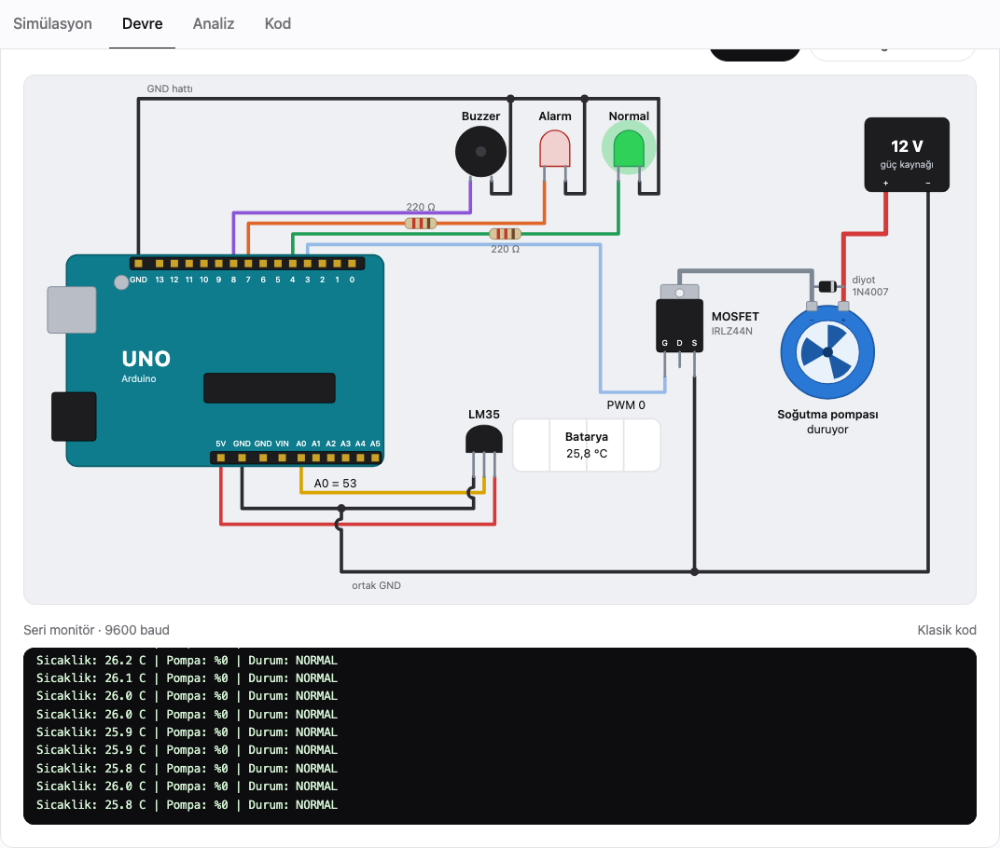
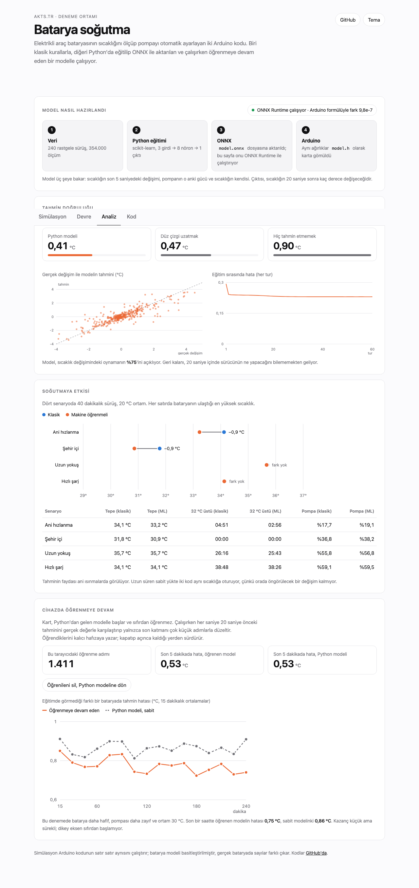
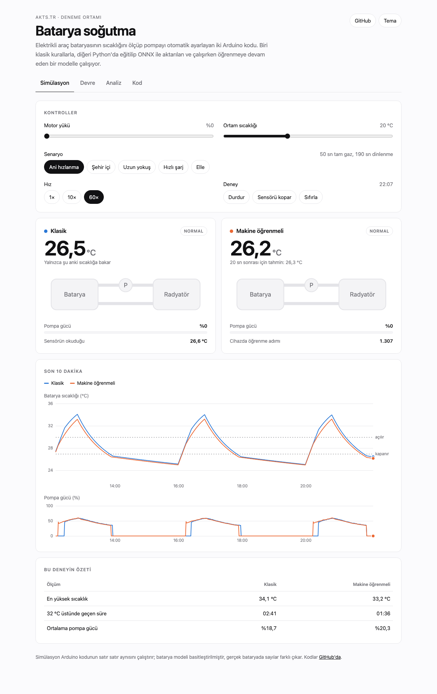

# Batarya Soğutma

Elektrikli araç bataryasının sıcaklığını ölçüp soğutma pompasını otomatik ayarlayan iki Arduino kodu: biri klasik kurallarla, diğeri makine öğrenmesiyle çalışır.

**Canlı deneme ortamı → [akts.tr/sogutma](https://akts.tr/sogutma/)**



## İçindekiler

| Klasör | Ne var |
|---|---|
| [`klasik/`](klasik/klasik.ino) | Makine öğrenmesi olmayan Arduino kodu |
| [`ml/`](ml/ml.ino) | Makine öğrenmeli Arduino kodu ve modelin ağırlıkları (`model.h`) |
| [`egitim/`](egitim/egit.py) | Modeli Python'da eğitip ONNX'e ve Arduino'ya aktaran betikler |
| [`site/`](site/index.html) | Deneme ortamı: simülasyon, canlı devre, analiz |
| [`test/`](test/calistir.sh) | Arduino kodunu bilgisayarda derleyip deneyen düzenek |

## İki sürüm

### Klasik

1. Saniyede bir, sensörden 10 ölçüm alıp ortalamasını hesaplar.
2. Sıcaklık 30 °C'ye çıkınca pompayı açar, 27 °C'ye inince kapatır. Aradaki 3 derecelik boşluk pompanın sürekli açılıp kapanmasını önler.
3. Pompa açıkken sıcaklık arttıkça gücü de artar, 45 °C'de tam güce ulaşır.
4. 55 °C'de alarm verir: kırmızı LED yanar, buzzer öter.
5. Sensör koparsa pompayı tam güçte çalıştırır ve alarm verir.

### Makine öğrenmeli

Klasik sürümün bütün kuralları geçerli. Üstüne, sıcaklığın **20 saniye sonra kaç derece değişeceğini** tahmin eden küçük bir sinir ağı eklenir. Pompa, şu anki sıcaklık ile tahmin edilen sıcaklıktan hangisi büyükse ona göre çalışır; böylece batarya hızla ısınmaya başladığında pompa beklemeden devreye girer.

Model üç şeye bakar:

- sıcaklığın son 5 saniyedeki değişimi
- pompanın o anki gücü
- sıcaklığın kendisi

## Model nereden geliyor

```
simülasyon verisi  →  Python eğitimi  →  model.onnx  →  site (ONNX Runtime)
   veri_uret.js          egit.py       ↘  model.h    →  Arduino
```

1. `egitim/veri_uret.js` simülasyonda 240 rastgele sürüş üretir (354 bin ölçüm).
2. `egitim/egit.py` scikit-learn ile 3 girdi → 8 nöron → 1 çıktı boyutunda bir ağ eğitir.
3. Aynı betik ağı `site/model.onnx` dosyasına aktarır ve ONNX Runtime çıktısının elle hesapla aynı olduğunu denetler.
4. Ağırlıklar `ml/model.h` olarak Arduino koduna gömülür. Deneme ortamı ise `model.onnx` dosyasını tarayıcıda ONNX Runtime ile çalıştırır.

### Cihazda öğrenmeye devam

Kart sıfırdan öğrenmez, Python'dan gelen modelle başlar. Çalışırken her saniye 20 saniye önceki tahminini gerçek değerle karşılaştırır ve ağın yalnızca son katmanını çok küçük adımlarla düzeltir. Öğrendiklerini 10 dakikada bir EEPROM'a yazar; kapatıp açınca kaldığı yerden sürdürür. Deneme ortamı da aynısını yapar ve öğrendiklerini tarayıcıda saklar.

## Ölçülen sonuçlar



**Tahmin doğruluğu** (modelin görmediği sürüşlerde, 20 saniye sonrası için ortalama hata):

| Yöntem | Hata |
|---|---|
| Python modeli | 0,41 °C |
| Düz çizgi uzatmak | 0,47 °C |
| Hiç tahmin etmemek | 0,90 °C |

**Soğutmaya etkisi** (40 dakikalık sürüş, 20 °C ortam, en yüksek batarya sıcaklığı):

| Senaryo | Klasik | Makine öğrenmeli |
|---|---|---|
| Ani hızlanma | 34,1 °C | 33,2 °C |
| Şehir içi | 31,8 °C | 30,9 °C |
| Uzun yokuş | 35,7 °C | 35,7 °C |
| Hızlı şarj | 34,1 °C | 34,1 °C |

Tahminin faydası ani ısınmalarda görülür. Uzun süren sabit yükte iki sürüm aynı sıcaklığa oturur, çünkü orada öngörülecek bir değişim kalmaz.

**Cihazda öğrenme:** eğitimde görmediği farklı bir bataryada dört saatin sonunda tahmin hatası 0,86 °C'den 0,75 °C'ye iner. Kazanç küçük ama süreklidir.

Batarya modeli basitleştirilmiştir; gerçek bir bataryada sayılar farklı çıkar.

## Bağlantılar (Arduino Uno)

| Parça | Uç | Nereye |
|---|---|---|
| LM35 sıcaklık sensörü | VCC / OUT / GND | 5V / A0 / GND |
| MOSFET (IRLZ44N) | Gate | D3 (PWM) |
| MOSFET (IRLZ44N) | Drain | Pompa − |
| MOSFET (IRLZ44N) | Source | Ortak GND |
| Pompa | + | 12 V kaynak + |
| Diyot (1N4007) | Çizgili uç | Pompa +, diğer uç pompa − |
| Buzzer | + | D8 |
| Kırmızı LED (220 Ω ile) | Uzun bacak | D7 |
| Yeşil LED (220 Ω ile) | Uzun bacak | D4 |
| 12 V kaynak | − | Ortak GND |

Pompa Arduino pininden beslenmez. Pin yalnızca MOSFET'i açıp kapatır, akım 12 V kaynaktan gelir. Diyot, pompa dururken oluşan ters gerilimden MOSFET'i korur.

## Deneme ortamı



- **Simülasyon:** iki kod aynı bataryada yan yana çalışır; yük, ortam sıcaklığı, senaryo ve hız ayarlanır.
- **Devre:** Arduino ve parçaların canlı bağlantı şeması; LED'ler, pompa ve seri monitör koda göre hareket eder.
- **Analiz:** model doğruluğu, senaryo karşılaştırmaları ve cihazda öğrenme.
- **Kod:** kaynak dosyalar.

Sitedeki simülasyon Arduino kodunun satır satır kopyasını çalıştırır.

## Kendi bilgisayarında çalıştırma

Test:

```
./test/calistir.sh
```

Modeli yeniden eğitme:

```
node egitim/veri_uret.js
pip install -r egitim/requirements.txt
python egitim/egit.py
node egitim/analiz.js
```

Siteyi açma:

```
./site/hazirla.sh
cd site && python3 -m http.server
```

## Neler denendi

- İki `.ino` dosyası bilgisayarda derlenip 3600 saniyelik sürüşte sitedeki kopyayla karşılaştırıldı; sonuçlar birebir aynı.
- Sensör koptuğunda iki sürümde de pompa tam güce çıkıyor.
- ONNX Runtime çıktısı ile Arduino'daki formül arasındaki fark milyonda bir düzeyinde.
- Cihazda öğrenme 24 saatlik simülasyonda kararlı kaldı.
- Kodlar `arduino-cli` ile derlendi. Gerçek kart üzerinde denenmedi. Sıcaklık formülü 5 V ve 10 bit ölçüm yapan Arduino Uno içindir.
